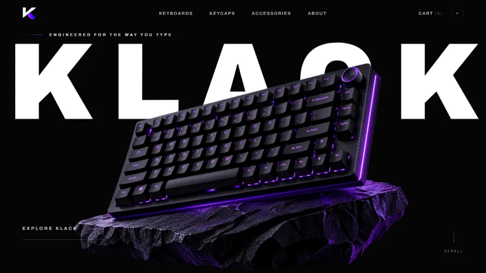

# KLACK

An interactive storefront concept for a mechanical keyboard brand. The page pairs a dark editorial layout with product imagery, scroll motion, a keycap video, and an accessory selector.

## Explore

- Open `index.html` directly, or serve this folder with `python -m http.server 5173`.
- The experience is built with HTML, CSS, and JavaScript. There is no build step.
- Keyboard sound is optional and starts muted.

## What I built

- Responsive product storytelling and layered scroll motion
- Accessible navigation, a skip link, and reduced-motion handling
- Video-backed keycap section and interactive accessory imagery
- Lightweight, self-hosted assets selected for this public showcase

This is a design and frontend concept. Cart, checkout, and product links are presentation elements rather than a connected commerce backend.
